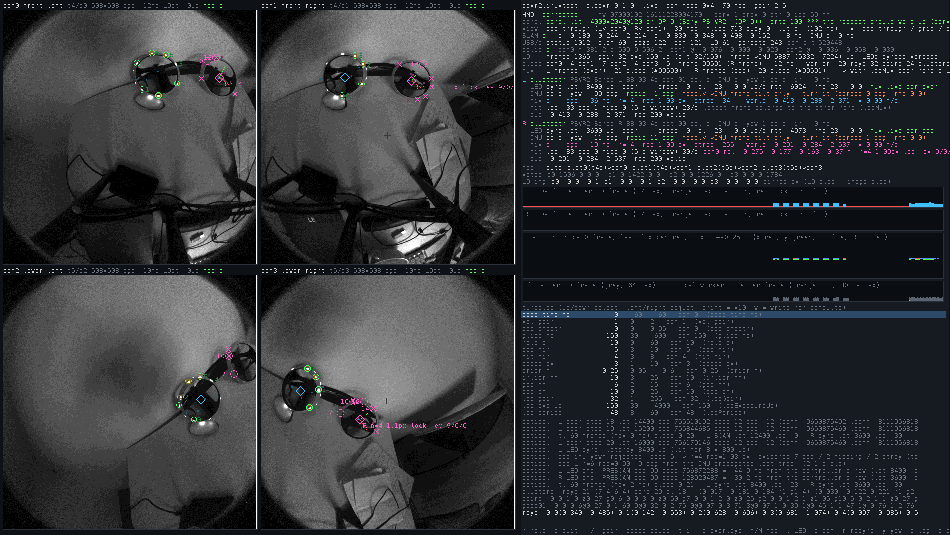
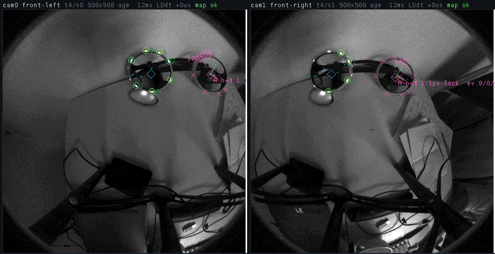

# slopvr

An experiment: run the PlayStation VR2 on Linux with everything the headset can do, as a native SteamVR driver in plain C. No Wine, no vendor driver, one shared library that SteamVR loads.

What works: the display at 120 Hz in direct mode, head tracking from the headset's own SLAM, eye tracking, both Sense controllers with full 6DoF tracking, buttons, sticks, touch, battery and haptics. The controllers appear as Oculus Touch controllers, so game bindings work unchanged.





## How it works

The headset is a USB device with one interface per function (SLAM pose and IMU, eye gaze, camera frames, status, the LED detector, factory calibration) and a DisplayPort panel that SteamVR drives in direct mode. The driver reads the streams through usbfs and publishes the poses.

Each Sense controller has a ring of 17 infrared LEDs that flash in a two millisecond window. The driver tells the controller when to flash on the controller's own clock, so that the flash lands in the exposure of the headset's tracking cameras; the headset reports the detected blobs, not images. The two controllers flash on alternating camera frames, which gives every blob a hand. The blobs of the four cameras are turned into rays, matched against the LED constellation with the orientation known from the controller IMU, and refined by Gauss-Newton to a position. A Kalman filter per axis integrates the IMU acceleration between the 30 Hz optical fixes, so the published pose is smooth and does not lag.

`psvr2linuxtest` is the same driver code in a window: the camera views, every detection and fit, the LED sync state, a guided calibration flow that runs inside the headset, and a recorder whose files can be replayed offline to tune the tracker.

## Install (NixOS)

In `configuration.nix`:

```nix
{
  imports = [ (builtins.getFlake "github:egbaydarov/slopvr").nixosModules.default ];
  services.slopvr.enable = true;
}
```

Then `nixos-rebuild switch`, log in again (or run `slopvr-install` once), pair the controllers over Bluetooth, start SteamVR. The module installs the udev rules, the Bluetooth setting the controllers need, `slopvr-install` and the test tool, and a user service that registers the driver with your SteamVR at every login, so an update is a rebuild and a new login. Pin a commit with `github:egbaydarov/slopvr/<commit>`; the unpinned form follows the branch and is refreshed when Nix's tarball cache expires (`nixos-rebuild switch --option tarball-ttl 0` forces it). With a flake based system: input `github:egbaydarov/slopvr`, module `nixosModules.default`. Options: `services.slopvr.testTool`, `registerAtLogin`, `bluetooth`, `package`.

On other distributions: `./build.sh install`, and `build/70-slopvr.rules` into `/etc/udev/rules.d`.

## Build

```
./build.sh           # driver (release build)      -> build/slopvr/, the Vulkan layer, the udev rules
./build.sh test      # psvr2linuxtest (debug build) -> build/psvr2linuxtest, needs SDL2, wayland-client, libdrm
./build.sh install   # driver, then register it with this user's SteamVR
```

A C compiler is all the driver needs. It is one unity build (`src/slopvr.c`) that talks to vrserver through the C++ vtable ABI declared in `src/ovr.h`; the Vulkan layer declares its slice of Vulkan in `src/vk.h`. SteamVR runs inside the Steam Linux Runtime with glibc 2.31, so `src/glibc.h` binds the few newer symbol versions a current glibc would pick to their old names, and `build.sh` refuses a driver that references anything newer. The release build logs events only; the debug build (`-DSLOP_DEBUG`, the test tool) has the per frame diagnostics, the packet dumps and the experiments. `nix develop` gives a shell with the test tool's libraries; `flake.nix` packages the same `build.sh` and holds the NixOS module.

## References

- Monado, https://gitlab.freedesktop.org/monado/monado: the Sense controller HID reports, IMU calibration, haptics and the LED command.
- PSVR2Toolkit, https://github.com/BnuuySolutions/PSVR2Toolkit: the headset features beyond the official driver and their report layouts.
- Ignition, https://github.com/BnuuySolutions/Ignition: the official Windows driver running on Linux, as a reference for what it sends.
- psvr2-linux-adapter, https://github.com/unterschall/psvr2-linux-adapter: the headset USB interfaces, camera frame format and display bring up.
- The official SteamVR driver for the PlayStation VR2 (psvr2.dll, decompiled with Ghidra): the LED flash command, the LED constellation, the camera calibration format and the LED detector packets.
- OpenVR, https://github.com/ValveSoftware/openvr: the driver interface behind `src/ovr.h`.
- SDL2, Wayland (`wp_drm_lease_v1` from wayland-protocols) and libdrm for the test tool.
